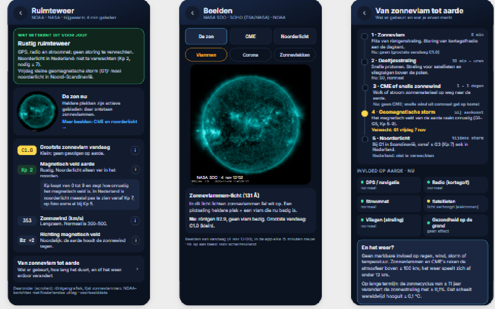

# CyberFirePulse | Android Applications
### From Prompt Engineering to Functional Software

**ENGLISH**

## Innovation Through Prompt Engineering

Welcome to the Android development section of **CyberFirePulse**, where Prompt Engineering plays a central role in the design, development, and continuous improvement of software applications.

This repository demonstrates how Artificial Intelligence, guided by structured instructions, technical expertise, and critical evaluation, can contribute to the development of functional Android applications.

**Prompt Engineering is not simply about asking AI to write code.** It is about translating ideas, functional requirements, architectural decisions, and technical challenges into precise instructions that produce measurable and verifiable results.

### Development Philosophy

The applications in this repository are developed around five core principles:

1. **Prompt-Driven Development** — Transforming functional requirements into structured, actionable AI instructions.
2. **Human Expertise and Validation** — Applying technical knowledge, testing, and critical assessment to AI-generated output.
3. **Iterative Engineering** — Improving functionality through controlled development cycles, feedback, and debugging.
4. **Security and Reliability** — Maintaining attention to software security, licensing, privacy, and application stability.
5. **Practical Innovation** — Creating applications that solve real problems and demonstrate the practical possibilities of AI-assisted software engineering.

### Android Applications

This repository contains Android applications covering different areas, including photography, weather monitoring, survival, information services, and educational technology.

Each project represents an opportunity to explore the relationship between human expertise and AI-assisted development.

#### Weer-Extremen

### Beyond Code Generation

The objective is not merely to generate applications faster, but to demonstrate how effective Prompt Engineering can support the complete software development lifecycle — from initial concept and architecture to implementation, testing, deployment, and maintenance.

**The quality of AI-assisted software development depends on the quality of its instructions, the expertise behind them, and the verification of the results.**

---

# CyberFirePulse | Android-applicaties
### Van Prompt Engineering naar functionele software

**NEDERLANDS**

## Innovatie door Prompt Engineering

Welkom bij de Android-ontwikkelsectie van **CyberFirePulse**, waar Prompt Engineering een centrale rol speelt bij het ontwerpen, ontwikkelen en voortdurend verbeteren van softwareapplicaties.

Deze repository laat zien hoe kunstmatige intelligentie, aangestuurd door gestructureerde instructies, technische expertise en kritische evaluatie, kan bijdragen aan de ontwikkeling van functionele Android-applicaties.

**Prompt Engineering is meer dan AI vragen om programmeercode te schrijven.** Het gaat om het vertalen van ideeën, functionele eisen, architectuurkeuzes en technische vraagstukken naar nauwkeurige instructies die leiden tot meetbare en controleerbare resultaten.

### Ontwikkelfilosofie

De applicaties binnen deze repository zijn gebaseerd op vijf uitgangspunten:

1. **Promptgestuurde ontwikkeling** — Functionele eisen vertalen naar gestructureerde en uitvoerbare AI-instructies.
2. **Menselijke expertise en validatie** — Technische kennis, testen en kritische beoordeling toepassen op door AI gegenereerde resultaten.
3. **Iteratieve ontwikkeling** — Functionaliteit verbeteren via gecontroleerde ontwikkelcycli, feedback en foutanalyse.
4. **Veiligheid en betrouwbaarheid** — Aandacht voor softwarebeveiliging, licenties, privacy en stabiliteit.
5. **Praktische innovatie** — Applicaties ontwikkelen die concrete problemen oplossen en de praktische mogelijkheden van AI-ondersteunde softwareontwikkeling demonstreren.

### Android-applicaties

Deze repository bevat Android-applicaties voor verschillende toepassingsgebieden, waaronder fotografie, weersmonitoring, survival, informatievoorziening en educatieve technologie.

Ieder project biedt mogelijkheden om de relatie tussen menselijke expertise en AI-ondersteunde softwareontwikkeling te onderzoeken.

#### Weer-Extremen

### Meer dan alleen code genereren

Het doel is niet uitsluitend om sneller applicaties te ontwikkelen, maar vooral om zichtbaar te maken hoe effectieve Prompt Engineering het volledige softwareontwikkelproces kan ondersteunen — van het eerste concept en de architectuur tot implementatie, testen, publicatie en onderhoud.

**De kwaliteit van AI-ondersteunde softwareontwikkeling wordt bepaald door de kwaliteit van de instructies, de technische expertise erachter en de controle van de resultaten.**

---

**CyberFirePulse**

*Engineering ideas into applications through structured prompting, technical expertise, and continuous validation.*

*Van ideeën naar applicaties door gestructureerde prompts, technische expertise en voortdurende validatie.*
